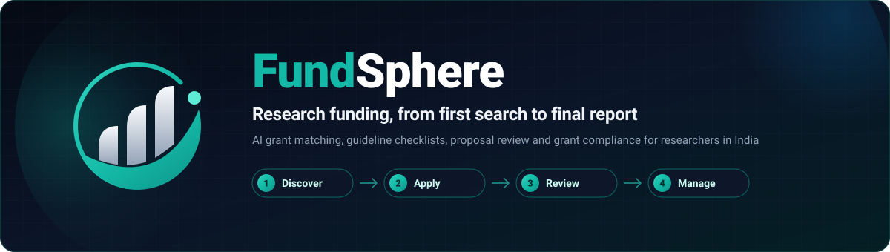
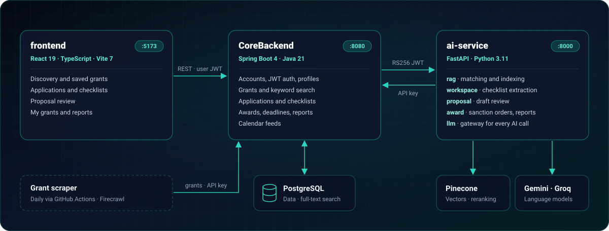

<p align="center">
  
</p>

<p align="center">
  <strong>Find research funding, prepare applications that meet every requirement, and stay on top of the grants you win.</strong>
</p>

<p align="center">
  
  
  
  
  
  
  
</p>

<p align="center">
  <a href="#features">Features</a> ·
  <a href="#architecture">Architecture</a> ·
  <a href="#getting-started">Getting started</a> ·
  <a href="#configuration">Configuration</a> ·
  <a href="#testing">Testing</a> ·
  <a href="#project-structure">Project structure</a> ·
  <a href="#documentation">Documentation</a>
</p>

---

## Overview

FundSphere covers a research grant from first search to final report. Researchers discover calls matched to their profile, turn a call's guidelines into a checklist they can work through, check proposal drafts against the call's rules before submitting, and track reporting deadlines, outputs and spending once a grant is awarded.

It is built for researchers in India. It indexes Indian funding agencies, shows amounts in lakh and crore, and knows the reporting rules of agencies such as ANRF (formerly SERB), DST and ICMR.

## Features

### Find funding

- **Browse** every indexed call, with filters for agency, grant type, applicant type, funding range and closing date, and sorting by recency, deadline or amount.
- **AI Match** ranks calls against the researcher's profile and an optional free-text query. Each result has a match score that breaks down into semantic fit, eligibility, keywords, funding fit and deadline, plus a short explanation.
- **Hard eligibility rules** remove calls the researcher can't apply for, such as those requiring a PhD, a citizenship or years of experience they don't have. Closed calls are left out.
- **Saved grants** keep a shortlist with private notes, showing what closes soonest and which saved calls already have an application.
- **Freshness**: each call shows when its source page was last verified.

### Prepare applications

- **Checklist from the guidelines**: upload a call's guidelines and FundSphere lists every document, format limit, eligibility proof, budget rule, submission detail and key date. Each item comes with the quote and page it was taken from.
- **Readiness tracker**: give each item an owner and a due date counted back from the call deadline, and see readiness as a percentage of required items done.
- **Sharing and reminders**: send the pending list, grouped by person, over WhatsApp, and add the deadline and due dates to a calendar (`.ics` download or Google Calendar).
- **Status tracking** from Preparing through Submitted to Awarded or Not funded, including calls found outside FundSphere.

### Review proposals

- **Instant check**: page count, word limits, fonts, paper size, line spacing, required sections and budget rules, measured from the PDF by code.
- **Full AI review**: a quality score marked against the call's evaluation criteria, judgement-based rules, and contradictions between sections, with the top fixes to make.
- **Versions**: every draft checked for an application is kept, so the score trend shows whether revisions help. A code-verified failure of a rule that would get the proposal returned caps the score at 49.
- **One-off checks** of any draft against any guidelines, without an application.

### Manage awarded grants

- **Set up from the sanction order**: FundSphere reads the sanction order PDF to fill in dates, amounts and budget heads.
- **Reporting deadlines** (utilisation certificates and statements of expenditure, progress reports, final reports, equipment lists) worked out from the project dates and the agency's rules, each editable when the sanction order says otherwise.
- **Calendar feed**: subscribe once in Google Calendar and every grant's deadlines stay in sync.
- **Outputs**: record papers (with ORCID import), students trained, equipment, patents and milestones.
- **Progress report drafts** written from the recorded objectives and outputs, with every claim checked against them, then edited in the browser and exported to Word.
- **Spend check**: compare each budget head's spending with its budget for the financial year and get warnings before money lapses.

## Architecture

FundSphere is three services: a React frontend, a Spring Boot backend that owns the data and authentication, and a Python AI service for search, document reading and AI review.

<p align="center">
  
</p>

| Service | Stack | Responsibilities |
|---|---|---|
| [`frontend/`](frontend) | React 19, TypeScript, Vite 7, Tailwind CSS 4, React Router 7, Framer Motion | All user interfaces: discovery, saved grants, applications, proposal review, grant management |
| [`CoreBackend/`](CoreBackend) | Java 21, Spring Boot 4, Spring Data JPA, Spring Security, PostgreSQL | Accounts and JWT auth, researcher profiles, grants and keyword search, applications and checklists, awards, deadlines, calendar feeds, reports, and the bridge to the AI service |
| [`ai-service/`](ai-service) | Python 3.11, FastAPI, Pinecone, Google Gemini, Groq, Firecrawl | Grant indexing and hybrid search, guideline and sanction-order extraction, proposal review, report drafting, and the grant scraper |

The browser only talks to `CoreBackend`. `CoreBackend` calls `ai-service` with short-lived RS256-signed tokens. `ai-service` calls back into `CoreBackend` (for keyword search and grant data) with a shared integration API key.

### How AI Match works

1. `CoreBackend` loads the researcher's full profile and forwards it with the query to `ai-service`.
2. The query is expanded with related terms. Optionally, HyDE writes a hypothetical call text to search with.
3. Two channels search in parallel: Pinecone hybrid search (dense `llama-text-embed-v2` plus sparse `pinecone-sparse-english-v0`), and PostgreSQL full-text search in `CoreBackend`.
4. The results are merged with Reciprocal Rank Fusion, then closed calls and hard eligibility conflicts are removed.
5. The remaining candidates are reranked with `bge-reranker-v2-m3` and scored on five signals: semantic fit 50%, eligibility 20%, keywords 10%, funding fit 10%, deadline 10%. The weights are configurable.
6. An LLM writes a short explanation for each top match. Results are cached per profile and query.

The weights and switches can be tuned against a labelled benchmark with the [offline evaluation](ai-service/eval/README.md).

### How grants get in

A scheduled scraper ([`scraper/smart_scheduler.py`](ai-service/scraper/smart_scheduler.py), run daily by a [GitHub Actions workflow](.github/workflows/scraper-cron.yml)) visits agency pages and hashes their content. Unchanged pages only refresh the grant's "verified" date. Changed pages are extracted into structured fields with Firecrawl and posted to `CoreBackend`, which saves them and has `ai-service` index them in Pinecone. A background sweeper retries any grant whose indexing failed.

### How proposal review works

The instant check measures the PDF with code. The full review reads the call's rules and evaluation criteria from the guidelines, then has the model judge each criterion and each judgement-based rule, with evidence. All AI calls go through one gateway ([`llm/gateway.py`](ai-service/llm/gateway.py)) that falls back across Gemini models and then Groq, respects rate limits, and records token usage per review. The design is described in [`docs/proposal-assistant-design.md`](docs/proposal-assistant-design.md).

## Getting started

### Prerequisites

| Tool | Version |
|---|---|
| Node.js | 20.19 or later (required by Vite 7) |
| Java | JDK 21 (the Maven wrapper is included) |
| Python | 3.11 or later |
| PostgreSQL | A recent release, with a database named `FundSphere` |
| Accounts | Pinecone, Google Gemini and Groq API keys; a Firecrawl key to run the scraper |

### 1. Create the database

```bash
createdb FundSphere
```

Tables are created and updated by Hibernate on startup (`ddl-auto=update`). One-off data fixes run as startup migrations in [`CoreBackend/.../migration`](CoreBackend/src/main/java/org/pramod/corebackend/migration).

### 2. Generate the service-to-service keys

`CoreBackend` signs its calls to `ai-service` with an RSA key pair. Generate it once (requires the Python `cryptography` package, which is in `ai-service/requirements.txt`):

```bash
python -c "
from cryptography.hazmat.primitives.asymmetric import rsa
from cryptography.hazmat.primitives import serialization
import os
key = rsa.generate_private_key(public_exponent=65537, key_size=2048)
priv = key.private_bytes(serialization.Encoding.PEM, serialization.PrivateFormat.PKCS8, serialization.NoEncryption())
pub = key.public_key().public_bytes(serialization.Encoding.PEM, serialization.PublicFormat.SubjectPublicKeyInfo)
os.makedirs('CoreBackend/src/main/resources/keys', exist_ok=True)
os.makedirs('ai-service/keys', exist_ok=True)
open('CoreBackend/src/main/resources/keys/m2m_private_key.pem', 'wb').write(priv)
open('CoreBackend/src/main/resources/keys/m2m_public_key.pem', 'wb').write(pub)
open('ai-service/keys/m2m_public_key.pem', 'wb').write(pub)
"
```

The `keys/` folders are git-ignored. Never commit the private key.

### 3. Configure the services

Create `CoreBackend/.env`:

```env
DB_USERNAME=postgres
DB_PASSWORD=your-postgres-password
JWT_SECRET=a-long-random-secret-of-at-least-256-bits
INTEGRATION_API_KEY=a-shared-random-key
```

Create `ai-service/.env` with at least:

```env
SPRING_BOOT_BASE_URL=http://localhost:8080
INTEGRATION_API_KEY=a-shared-random-key        # same value as in CoreBackend/.env

PINECONE_API_KEY=your-pinecone-key
PINECONE_INDEX_HOST=https://your-index-host.pinecone.io

GEMINI_API_KEY=your-gemini-key                 # reviews, extraction and drafting
GROQ_API_KEY=your-groq-key                     # fallback when Gemini is rate-limited
GROQ_API_KEY_QUERY_EXPANSION=your-groq-key     # AI Match query expansion
GROQ_API_KEY_LLM_JUDGE=your-groq-key           # AI Match explanations

FIRECRAWL_API_KEY=your-firecrawl-key           # only needed for the scraper
```

Without the two AI Match Groq keys, matching still works, but without query expansion and explanations. The Pinecone index must use 1024 dimensions and the `dotproduct` metric (dense and sparse vectors together). See [Configuration](#configuration) for the optional settings.

The frontend reads the backend URL from `frontend/.env.local`. Copy [`frontend/.env.example`](frontend/.env.example) and change it if your backend isn't at `http://localhost:8080`.

### 4. Run

Start the three services in separate terminals:

```bash
# CoreBackend: http://localhost:8080
cd CoreBackend
./mvnw spring-boot:run
```

```bash
# ai-service: http://localhost:8000
cd ai-service
python -m venv .venv
source .venv/bin/activate          # Windows: .venv\Scripts\activate
pip install -r requirements.txt
uvicorn main:app --reload --port 8000
```

```bash
# frontend: http://localhost:5173
cd frontend
npm install
npm run dev
```

### 5. Load grants

With the backend and AI service running, run the scraper once to fetch grants, then index everything already in the database:

```bash
cd ai-service
python -m scraper.smart_scheduler --max 8
python index_all_grants.py
```

## Configuration

### CoreBackend

Settings live in [`application.properties`](CoreBackend/src/main/resources/application.properties). Secrets come from the environment or `CoreBackend/.env`.

| Setting | Purpose |
|---|---|
| `DB_USERNAME`, `DB_PASSWORD` | PostgreSQL credentials |
| `JWT_SECRET` | Signs user access tokens (15 minutes) and refresh tokens (7 days) |
| `INTEGRATION_API_KEY` | Shared key the AI service and scraper use to call the backend |
| `app.frontend.origin` | Allowed CORS origin (default `http://localhost:5173`) |
| `app.public-base-url` | Optional public URL of the backend, used in calendar subscription links |
| `orcid.api.token` | Optional ORCID API token for profile and publication import |

Set `SPRING_PROFILES_ACTIVE=dev` to log SQL statements.

### ai-service

Every setting has a default in [`rag/config.py`](ai-service/rag/config.py) and [`llm/gateway.py`](ai-service/llm/gateway.py). The ones you are most likely to change:

| Setting | Default | Purpose |
|---|---|---|
| `PROPOSAL_GEMINI_MODEL` | `gemini-2.5-flash` | Main model for reviews, extraction and drafting |
| `PROPOSAL_GEMINI_FALLBACK_MODEL` | none | Comma-separated Gemini models to try when the main one is rate-limited |
| `ENABLE_HYDE` | `false` | Search with a hypothetical call text as well as the query (needs `GROQ_API_KEY_HYDE`) |
| `ENABLE_HARD_ELIGIBILITY_FILTER` | `true` | Drop calls that conflict with the profile |
| `EXCLUDE_EXPIRED_GRANTS` | `true` | Leave closed calls out of matches |
| `WEIGHT_SEMANTIC` … `WEIGHT_FRESHNESS` | `0.50`, `0.20`, `0.10`, `0.10`, `0.10` | Match score weights |
| `ENABLE_QUERY_CACHE` | `true` | Cache match results (`QUERY_CACHE_TTL_SECONDS`, default 1800) |
| `LLM_MAX_CONCURRENCY` | `3` | Parallel AI calls per process |

## Testing

```bash
# CoreBackend unit tests
cd CoreBackend && ./mvnw test

# ai-service unit tests
cd ai-service && python -m unittest discover -s tests

# frontend lint and production build (includes type-checking)
cd frontend && npm run lint && npm run build
```

Match quality is measured separately with the offline evaluation in [`ai-service/eval`](ai-service/eval/README.md). It reports Recall@10, MRR and NDCG@10 over a set of test researchers, and can compare two configurations or suggest better score weights:

```bash
cd ai-service
python -m eval.run                              # score the current settings
python -m eval.run --compare ENABLE_HYDE=true   # compare against a changed setting
python -m eval.run --tune                       # suggest WEIGHT_* values
```

## Project structure

```
FundSphere/
├── frontend/                 React + TypeScript app
│   └── src/
│       ├── components/       discovery, saved-grants, applications, proposal-review,
│       │                     awards, profile, onboarding, auth, landing, common
│       ├── services/         API clients
│       ├── hooks/, context/  shared state
│       └── utils/            dates, deadlines, filters, formatting
├── CoreBackend/              Spring Boot API
│   └── src/main/java/org/pramod/corebackend/
│       ├── controller/       REST endpoints
│       ├── service/          business logic and the AI service client
│       ├── entity/, dto/, repository/, enums/
│       ├── security/         user JWT and service-to-service auth
│       └── migration/        one-off startup data migrations
├── ai-service/               FastAPI service
│   ├── rag/                  indexing, hybrid search, scoring, match explanations
│   ├── proposal/             proposal review pipeline
│   ├── workspace/            checklist extraction from call guidelines
│   ├── award/                sanction-order reading and progress-report drafting
│   ├── llm/                  gateway for every AI call
│   ├── scraper/              scheduled grant scraper
│   ├── eval/                 offline match-quality evaluation
│   └── tests/
├── docs/                     design and architecture notes
└── assets/                   logo and banner
```

## Documentation

- [`docs/architecture.md`](docs/architecture.md): diagrams of the matching engine and the proposal review flow
- [`docs/proposal-assistant-design.md`](docs/proposal-assistant-design.md): design of the proposal review, its rules and scoring
- [`ai-service/eval/README.md`](ai-service/eval/README.md): how match quality is measured and tuned

## Security

- Secrets are read from the environment or `.env` files, which are git-ignored, as are the RSA keys.
- Users authenticate with short-lived JWT access tokens. Refresh tokens are single-use: each refresh revokes the old one and issues a new one.
- Calls from `CoreBackend` to `ai-service` carry RS256 tokens signed with the backend's private key and verified with its public key. Calls the other way use the shared integration key.
- Uploaded PDFs are limited to 30 MB per file.

---

<p align="center">
  <br>
  <sub>FundSphere</sub>
</p>
